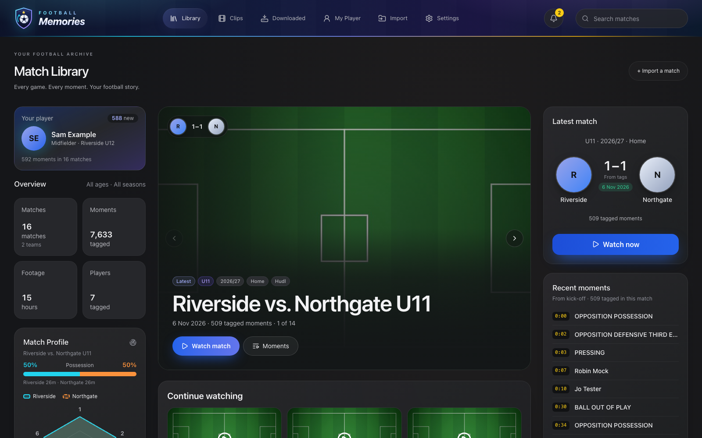
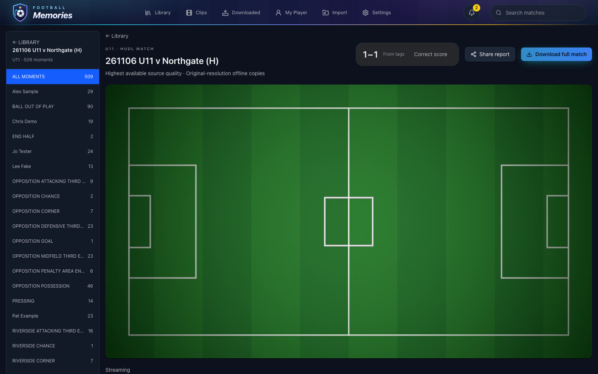
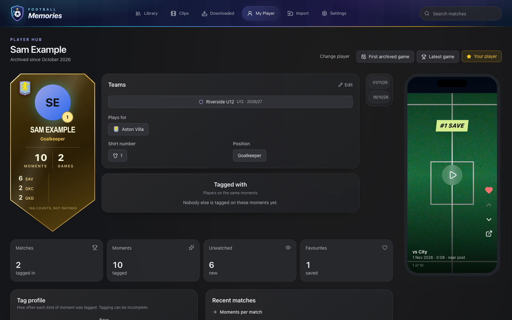
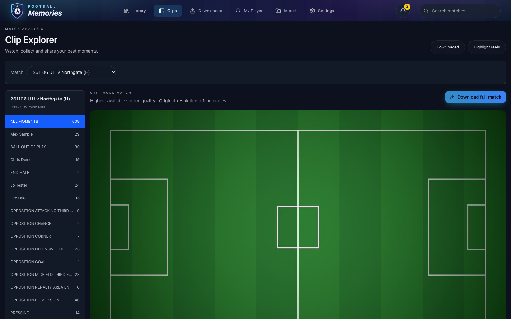
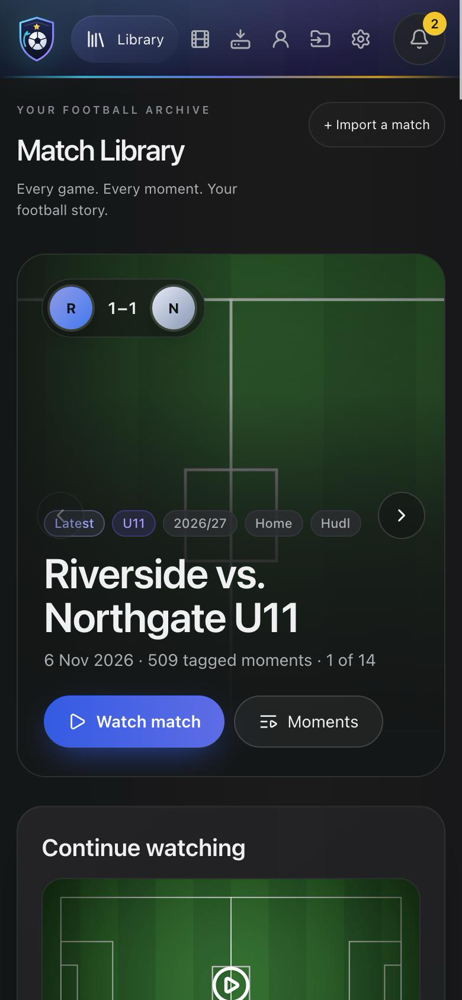

# Football Memories

A private, local-first archive of a young player's football: every match,
every tagged moment and every highlight, kept safely on your own computer.

Connect your Hudl account (with your own permission to automate and download),
stream matches at the best available quality, jump straight to tagged moments,
download the ones that matter and turn them into shareable highlight reels with
animated title cards. Nothing is uploaded anywhere.



## What it does

- **Match Library**: every match with both clubs' crests, the newest first. Icons show
  which matches and moments you have already downloaded. Overview stats follow the
  age group and season you pick.
- **Match page**: watch the whole game or only the tagged moments, filter by
  moment type or player, and play tagged moments back to back.
- **Clips**: pick a match, choose a player or code, and download their moments as
  separate clips, one video, or straight into a highlight reel. **Batch download**
  does the same across many matches in one go.
- **Highlight reels**: six animated card styles (Floodlights, Kick-off, Trophy
  gold, Neon, Matchday poster, Clean). Each match gets its own opening card,
  filled in automatically with both crests, the opponent and the date.
- **Downloaded**: every full match, moment set and reel on this computer, with
  Play and Save buttons.
- **My Player**: a player card in seven finishes (gold, silver, bronze and more)
  showing the club crest, moments and games, plus a memories timeline.
- **Phones and tablets**: open the app from any device on your home Wi-Fi.
- **Updates**: Settings > Update checks GitHub and updates in one click.

| Match page | Player hub |
|---|---|
|  |  |

| Clips | On a phone |
|---|---|
|  |  |

Screenshots use the built-in sample data, not real players.

## Installing

Football Memories runs on **Mac** and **Windows**. It needs
**[Docker Desktop](https://www.docker.com/products/docker-desktop/)**, and
the installer sets that up for you if it is missing.

1. Download this repository (green **Code** button > **Download ZIP**, or clone
   it with git so the app can update itself later).
2. Open the folder and double-click the installer for your computer:

   | Computer | Double-click |
   |---|---|
   | Mac | `Install Football Memories.command` |
   | Windows 10 / 11 | `Install Football Memories.bat` |

3. Follow any prompts. The installer:
   - installs **Docker Desktop** if needed and starts it (the first time, accept
     Docker's terms in its window; on Windows it first turns on WSL 2 and may ask to restart)
   - installs what the Hudl connection needs: ffmpeg, the uv Python runner and
     Google Chrome (on a Mac it asks before installing Homebrew)
   - creates your settings with a random database password
   - builds and starts the app, starts the Hudl helper, and opens
     **http://127.0.0.1:8765** in your browser
   - prints the address to use on your phone, for example
     `http://YourComputer.local:8765`

The first run takes several minutes while Docker builds the app. After that,
double-click the same installer any time to start the app or update it. It
never deletes or overwrites your matches, downloads, settings or database.

If your Mac says the file is from an unidentified developer, right-click it and
choose **Open**. On Windows, if SmartScreen appears, choose **More info > Run anyway**.

**Windows: "Smart App Control blocked a file that may be unsafe".** Windows 11
blocks `.bat` files downloaded in a browser, and there is no "run anyway". Use
this instead: open the Start menu, type **PowerShell**, press Enter, paste this
line and press Enter:

```powershell
irm https://raw.githubusercontent.com/MooreSi/Football-Memories/main/install-windows.ps1 | iex
```

It downloads the app to your user folder (`Football Memories`) without the
"from the internet" mark and runs the same installer. Already unzipped a copy?
Right-click the ZIP (or `Install Football Memories.bat`) > **Properties** >
tick **Unblock** > **OK**, then double-click the installer again.

**Windows: WSL.** Docker needs WSL 2 and Virtual Machine Platform. The
installer checks for them first and, if missing, turns them on after one
Windows permission prompt (choose **Yes**), then asks to restart and carries on
by itself after the restart.

### Connecting Hudl

In the app, open **Settings > Connections**, enter your Hudl email and password,
press **Save**, then **Test**. The password is kept only in the macOS Keychain
or Windows Credential Manager, never in a file. Keep the helper running (on
Windows it is the minimised "Football Memories Hudl helper" window) while you use Hudl.

Hudl's terms forbid automated access without permission. Use this only for an
account and footage you have permission to automate and download.

## Good to know

- **Privacy**: everything stays on your computer. On your home network the app
  has no password, so anyone on the same Wi-Fi can open it. To keep it to this
  computer only, set `FM_BIND=127.0.0.1` in the `.env` file and run the
  installer again.
- **Disk space**: full matches are several GB each. Settings > Storage shows free
  space and lets you move downloads to the Trash or Recycle Bin.
- **Backups**: Settings > Backups makes a daily backup of your library database.

## Licence

[MIT](LICENSE). Developer notes live in [docs/](docs/).
